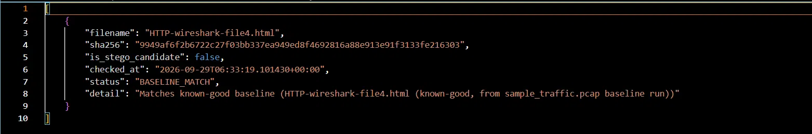
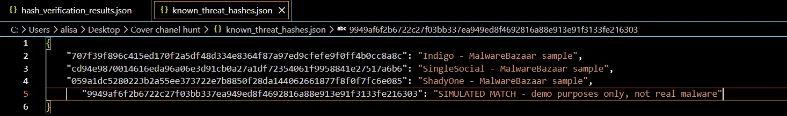
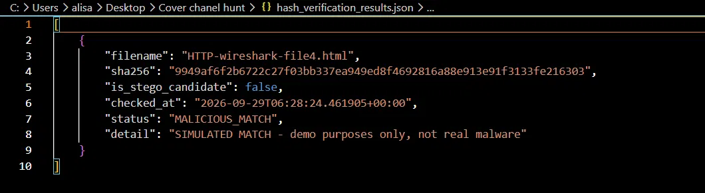
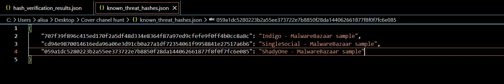

# Hash Verification Module (Integrity & Hashing)

## What this module does

This module checks the integrity of files extracted from network traffic captures. After `Packet_engine.py` pulls files out of a `.pcap` (packet capture) and records each one's SHA-256 hash in `payload_manifest.json`, this module cross-checks those hashes against two reference lists:

- **`baseline_hashes.json`** — hashes of files already confirmed to be clean/expected
- **`known_threat_hashes.json`** — hashes of files known to be malicious

Every file gets one of three verdicts:

| Status | Meaning |
|---|---|
| `BASELINE_MATCH` | File is identical to a known-good file — safe |
| `MALICIOUS_MATCH` | File's hash matches a known threat — alert |
| `UNVERIFIED` | File hasn't been seen before — needs manual review |

## Why hashing?

A SHA-256 hash is a fixed-length "fingerprint" generated from a file's exact contents. Identical files always produce the same hash; changing even a single byte produces a completely different hash. This makes hashing a fast, reliable way to detect whether a file is unmodified, previously seen, or matches a known threat — without needing to compare files byte-by-byte or rely on filenames (which can be spoofed).

## How it works

1. `run_analysis.py` runs `Packet_engine.py`'s `analyze_pcap()` against the team's traffic captures (`sample_traffic.pcap`, `dns_attack.pcap`), which extracts any files transferred over HTTP and writes `payload_manifest.json` with each file's name, size, and SHA-256 hash.
2. `verify_hashes.py` reads `payload_manifest.json` and checks each file's hash against `baseline_hashes.json` and `known_threat_hashes.json`.
3. Results are written to `hash_verification_results.json`, giving a clear verdict per file.

## Files in this module

- `run_analysis.py` — runs the extraction pipeline against the team's pcaps
- `verify_hashes.py` — performs the hash verification
- `baseline_hashes.json` — known-good file hashes
- `known_threat_hashes.json` — known-malicious file hashes (sourced from [MalwareBazaar](https://bazaar.abuse.ch/))

## Usage

```bash
python run_analysis.py     # produces payload_manifest.json
python verify_hashes.py    # produces hash_verification_results.json
```

## Testing & results

### Baseline match (real traffic sample)

Running the module against `sample_traffic.pcap` correctly identified the extracted file (`HTTP-wireshark-file4.html`) as matching the known-good baseline:



### Malicious match (simulated)

To confirm the alert path actually triggers, the same file's hash was temporarily added to `known_threat_hashes.json` as a simulated threat entry:



Re-running the verifier correctly flagged it as `MALICIOUS_MATCH`:



The simulated entry was then removed, and the file was confirmed to correctly revert to `BASELINE_MATCH`:



This confirms the module correctly distinguishes between known-good, known-bad, and reacts to changes in the reference hash lists as expected.
